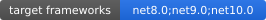

# Jenin FontAwesome Blazor

[](https://www.nuget.org/packages/Jenin.FontAwesome.Blazor/)
[](https://www.nuget.org/packages/Jenin.FontAwesome.Blazor/)
[](https://github.com/TarekNajem04/Jenin.FontAwesome.Blazor/blob/main/LICENSES)
[](https://github.com/TarekNajem04/Jenin.FontAwesome.Blazor/)

   

* Free Font Awesome components for ASP.NET Blazor
* Targets .NET 8.0, .NET 9.0, and .NET 10.0; Blazor WebAssembly, Blazor Server, and Blazor Web App samples included (all four Blazor Web App render modes verified)
* Browse the [documentation site](https://tareknajem04.github.io/Jenin.FontAwesome.Blazor/) for live, copy-pasteable examples, an icon browser, and the full component catalogue
* Browse the [generated API reference](https://tareknajem04.github.io/Jenin.FontAwesome.Blazor/api/api/) for the full public surface of the seven API-documented packages (`Jenin.FontAwesome.Blazor`, `.IconPicker`, `.Icons`, `.Svg`, `.Analyzers`, `.MudBlazor`, `.Blazorise` — the template pack ships no binaries to document); every compiled package ships XML documentation for IntelliSense
* See [CHANGELOG.md](CHANGELOG.md) for release notes and [MIGRATION.md](MIGRATION.md) for the 1.x → 2.0 upgrade guide

Getting started
===============

Prerequisites
-------------

Jenin.FontAwesome.Blazor components have the following requirements:

*   .NET SDK pinned by `global.json` (10.0.204+ with `latestFeature` roll-forward) to build the
    repository; consuming apps need the targeting packs for .NET 8.0, .NET 9.0, or .NET 10.0
    (the libraries target `net8.0;net9.0;net10.0`)
*   Any Blazor hosting model: Blazor WebAssembly, Blazor Server, or a Blazor Web App (static server-side rendering, Interactive Server, Interactive WebAssembly, Interactive Auto)

Installation
------------

### 1\. Install the package

Find the [Jenin.FontAwesome.Blazor](https://www.nuget.org/packages/Jenin.FontAwesome.Blazor/) package through NuGet Package Manager or install it with following command:

    dotnet add package Jenin.FontAwesome.Blazor

> **Release status:** `2.0.0` is live on nuget.org — eight packages: core
> `Jenin.FontAwesome.Blazor` plus `IconPicker`/`Icons`/`Svg`/`Analyzers`/MudBlazor-Blazorise
> adapters/template pack. For pre-release builds use a local pack feed
> (`dotnet pack <project> -o feed` plus a `NuGet.config` pointing at it).

### 2. Wire the assets (one line + one component)

Register the services, map the generated mode-config endpoint, and drop one component into
`<head>` — no hand-written `<script>` tags:

```csharp
// Program.cs
builder.Services.AddJeninFontAwesome();

var app = builder.Build();
// ... standard middleware (MapStaticAssets, antiforgery, ...)

app.MapJeninFontAwesomeAssets(options => {
    options.AssetMode = FontAwesomeAssetMode.SvgNest; // or FontAwesomeAssetMode.Webfont
    options.StyleSheetUrl = "/fontawesome/css/all.css";   // your hosted FA CSS (or a CDN copy)
    options.JavaScriptUrl = "/fontawesome/js/all.min.js"; // your hosted FA runtime (or CDN/Kit)
});
```

```razor
@* App.razor <head> (or the root component's head) *@
<FontAwesomeHeadAssets />
```

The map call serves the mode config from
`/_content/Jenin.FontAwesome.Blazor/js/fontawesome-config-auto.js`, generated from the
registered options so the served config can never drift from the mode; the head component
renders the stylesheet link, the config script, and the runtime script in load order. Font
Awesome's own files stay host-owned — the library never downloads them; configure your
self-hosted paths, a CDN copy, or a Kit URL.

- **SVG+JS nesting** (`SvgNest`, the default): full feature set — duotone, masks, layers,
  power transforms — safe with Blazor rendering. Standalone WebAssembly hosts have no server
  pipeline, so skip the map call there: the head component falls back to the matching static
  config file automatically.
- **Static webfonts** (`Webfont`): use only when SVG enhancement is unavailable. The same two
  calls wire `autoReplaceSvg: false`; see the
  [Webfont vs SVG: feature support matrix](#webfont-vs-svg-feature-support-matrix) for what
  keeps working in this mode.

### 2 (alternative). Manual wiring

Prefer to own every tag? Skip the map call and the head component, keep
`services.AddJeninFontAwesome()` for the component defaults, and write the tags by hand:

    <!DOCTYPE html>
    <html lang="en">
    <head>
        <meta charset="utf-8" />
        <meta name="viewport" content="width=device-width, initial-scale=1.0" />
        <base href="~/" />
    
        <!-- Load Font Awesome styles (host your own FA assets or use a CDN) -->
        <link href="/your-path-to-fontawesome/css/all.css" rel="stylesheet">
    
        ...
    </head>
    <body>
        ...
    </body>
    </html>

See Font Awesome docs: [Host yourself](https://fontawesome.com/docs/web/setup/host-yourself) (choose Web Fonts or SVG/Kit as appropriate).

#### Manual JavaScript

Load the library's config before the Font Awesome runtime, then load Font Awesome. The config sets `window.FontAwesomeConfig.autoReplaceSvg` non-destructively.

**Recommended (Enhanced/SVG with nesting):** allows Layers, Masks, Transforms, etc. and is safe with Blazor rendering.

    <script src="_content/Jenin.FontAwesome.Blazor/js/fontawesome-config-nest.js" type="text/javascript"></script>
    <script src="/your-path-to-fontawesome/js/all.min.js" type="text/javascript"></script>

**Static/Webfont mode:** use only if you cannot use SVG enhancement.

    <script src="_content/Jenin.FontAwesome.Blazor/js/fontawesome-config-webfont.js" type="text/javascript"></script>
    <script src="/your-path-to-fontawesome/js/all.min.js" type="text/javascript"></script>

> Note: When using webfont mode (`autoReplaceSvg: false`), certain features such as Layers are not supported by Font Awesome. The library ships no Font Awesome assets; you must host or reference your own Font Awesome files. See the [Webfont vs SVG: feature support matrix](#webfont-vs-svg-feature-support-matrix) for what keeps working in this mode.

Place these near the end of `<body>` (before `blazor.*.js` as appropriate for your host).

### 3. Import namespaces

Add to your `_Imports.razor` file:

    @using Jenin.FontAwesome.Blazor
    @using Jenin.FontAwesome.Blazor.Animations
    @using Jenin.FontAwesome.Blazor.Components
    @using Jenin.FontAwesome.Blazor.Transformations

**Example**

    <Icon CssClass="me-4"
          IconStyle="IconStyle.Solid"
          IconName="fa-star"
          Animation="@Animate.Spin().SetDelay(TimeSpan.FromSeconds(2)).SetDuration(TimeSpan.FromSeconds(60))"
          Color="gold" />

**Quick usage**

    <button class="btn btn-outline-primary mb-4 ms-2 d-flex align-items-center gap-2" @onclick="GotoStartPage">
        <Icon IconStyle="IconStyle.Solid" IconSize="IconSize.X02" IconName="fa-bell" Animation="@Animate.Shake()" Color="gold" />
        <span>Are you ready?</span>
    </button>

**Licensed Pro assets:** the same setup works unchanged — point the two URLs at your kit or
self-hosted Pro files. See [docs/pro-setup.md](docs/pro-setup.md) for the Pro/Free contract
and the repeatable render verification (`eng/verify-pro-render.ps1`), and
[docs/hosting-with-kits.md](docs/hosting-with-kits.md) for the first-class Kit setup
(`UseFontAwesomeKit`), auto-subsetting notes, and custom kit icons.

**Your own glyphs:** register them once and use the same typed API, search, picker, and
snippets — see [docs/custom-icons.md](docs/custom-icons.md).

**AI consumers:** [llms.txt](llms.txt) summarizes the API, modes, and docs for assistants,
and the [cookbook](samples/Jenin.FontAwesome.Blazor.Sample.Shared/Pages/Cookbook/Cookbook.razor)
(`Cookbook` page in the sample app) gives 15 copy-paste recipes, each e2e-verified.

**Need whole screens, not snippets?** The [gallery](samples/Jenin.FontAwesome.Blazor.Sample.Shared/Pages/Gallery/Gallery.razor)
(`Gallery` page in the sample app) composes five real screens — dashboard, notifications,
timeline, settings, inbox — each e2e-verified including mobile and dark theme.

**Already on MudBlazor or Blazorise?** Map typed names straight into their icon slots with the
`Jenin.FontAwesome.Blazor.MudBlazor` and `Jenin.FontAwesome.Blazor.Blazorise` adapter packages —
see [docs/using-with-ui-suites.md](docs/using-with-ui-suites.md) (adapter packages are new in
2.0).

**Compile-time guidance:** the optional `Jenin.FontAwesome.Blazor.Analyzers` package (new in 2.0) warns on
unknown icon names (`JFA1001`), raw class strings in name positions with a code fix to the typed
equivalent (`JFA1002`), and Pro-only styles without licensed assets (`JFA1003`) — never errors,
`.editorconfig`-tunable. See [docs/diagnostics.md](docs/diagnostics.md) for the full list.

### Project templates

Start from a working app instead of wiring one up. The template pack ships with 2.0:
install it by ID (`dotnet new install Jenin.FontAwesome.Blazor.Templates`). For pre-release
builds install from a local pack instead
(`dotnet pack templates/Jenin.FontAwesome.Blazor.Templates.csproj -o feed`, then
`dotnet new install feed/Jenin.FontAwesome.Blazor.Templates.2.0.0.nupkg`).
Then scaffold:

```powershell
dotnet new jenin-fa-blazor -n MyApp            # Blazor Web App, SVG+JS nesting
dotnet new jenin-fa-blazor -n MyApp --FaMode Webfont
dotnet new jenin-fa-blazor-wasm -n MyWasmApp   # standalone WebAssembly
```

Parameters: `--Framework net8.0|net9.0|net10.0` (default `net10.0`); `--FaMode` (`SvgNest|Webfont`
for the Web App, `nest|webfont` for WASM); `--JfaVersion` (default `2.0.0`). The templates restore
with no extra setup. Every template is
smoke-verified end to end — `pwsh ./eng/verify-templates.ps1` scaffolds each one with no edits,
builds, runs, and asserts the first icon renders (SSR markup for the Web App, plus a
headless-browser DOM check for WebAssembly).

### Switching from another library

Coming from MudBlazor, Blazorise, EasyAppDev, Blazicons, or raw FA class strings? Each guide
below has an API mapping table, worked before/after diffs, and a checklist — and every
mapping is verified by render tests in `tests/Jenin.FontAwesome.Blazor.Tests/Migration/`.

- [From MudBlazor (`MudIcon` / `MudIconButton`)](docs/migration/from-mudblazor.md)
- [From Blazorise (`Icon` + Font Awesome provider)](docs/migration/from-blazorise.md)
- [From EasyAppDev FA5 / FA6](docs/migration/from-easyappdev.md)
- [From Blazicons.FontAwesome](docs/migration/from-blazicons.md)
- [From raw Font Awesome class strings](docs/migration/from-raw-fontawesome.md)

    @code {
        [Inject]
        private NavigationManager NavigationManager { get; set; }

        private void GotoStartPage() => NavigationManager.NavigateTo("/icon-basics-style");
    }

**Typed icon names**

`IconName` also accepts the compile-time constants generated from the Font Awesome Free metadata, giving
IntelliSense and typo-proofing without string literals:

    <Icon IconStyle="IconStyle.Solid" IconName="@IconNames.Solid.House" />
    <Icon IconStyle="IconStyle.Regular" IconName="@IconNames.Regular.Star" />
    <Icon IconStyle="IconStyle.Brands" IconName="@IconNames.Brands.Github" />

The constants (`Solid`, `Regular`, `Brands`) are generated from Font Awesome Free 7.3.1 by
`eng/generate-icon-catalogue.ps1`. After upgrading Font Awesome, refresh the vendored metadata and
regenerate: `pwsh ./eng/update-fontawesome-metadata.ps1 -Version <version>` then
`pwsh ./eng/generate-icon-catalogue.ps1`.

---

## Supported Environments

- .NET 8.0, .NET 9.0, and .NET 10.0
- Blazor WebAssembly, Blazor Server, and Blazor Web App (all four render modes)
- Font Awesome (hosted by you; config is version-agnostic; samples use Font Awesome Free 7.3.1)

### Verified hosting models and render modes

The samples cover each supported hosting model with the same component markup:

| Hosting model | Sample | Coverage |
|---|---|---|
| Blazor Web App (server-rendered pages host) | `samples/Jenin.FontAwesome.Blazor.Sample` | `net10.0` |
| Blazor WebAssembly (standalone) | `samples/Jenin.FontAwesome.Blazor.Wasm.Sample` | `net10.0` |
| Blazor Web App (server + `.Client`) | `samples/Jenin.FontAwesome.Blazor.WebApp.Sample` | `net10.0` |

The Blazor Web App sample exercises every render mode; the render mode is the only thing that
changes between these pages:

| Render mode | Sample page | Interactivity | Prerendered |
|---|---|---|---|
| Static server-side rendering (no `@rendermode`) | `/`, `/static-ssr` | None — markup only, no event handlers | n/a (static HTML only) |
| Interactive Server | `/interactive-server` | SignalR circuit, executes on the server | Yes |
| Interactive Server (`prerender: false`) | `/interactive-server-no-prerender` | SignalR circuit, executes on the server | No — markup appears once the circuit connects |
| Interactive WebAssembly | `/interactive-webassembly` | Executes in the browser | Yes |
| Interactive Auto | `/interactive-auto` | Server first, then the browser once the runtime is downloaded | Yes |

**Prerendering and hydration notes:**

- Prerendered interactive modes render HTML on the server and then hydrate it in place. Font Awesome
  enhances the prerendered markup as soon as the script loads, so icons are visible before the
  interactive renderer takes over.
- The non-prerendered Interactive Server page is the only interactive mode whose initial response
  contains no icon markup for the component; it appears after the circuit connects.
- Static SSR pages never hydrate. Blazor event handlers (`OnClick`, `OnDoubleClick`, and friends) do
  not run there, so they produce markup without behaviour — use an interactive render mode for
  interactive icons.
- The library keys its Font Awesome-enhanced boundary element by a signature version, so re-enhancement
  after hydration (or after a parameter change) is safe.

CI publishes `samples/Jenin.FontAwesome.Blazor.WebApp.Sample` alongside the other two samples, and the
render-mode matrix above is re-validated manually against the running sample after component changes.

### Browser-level verification (CI gate)

`tests/e2e` runs Playwright against the live sample host and is a required CI job
(`e2e-browser`). It proves the end-to-end behavior MSTest cannot: Font Awesome's actual DOM
replacement, transform/mask/layering/accessibility tokens surviving the replacement, the RCL static
assets being served, re-enhancement after Blazor re-renders a boundary subtree on parameter
changes, and a healthy (hidden) Blazor error UI. Run it locally with
`cd tests/e2e && npm ci && npx playwright install --with-deps chromium && npm test`.

### Trimming & Native AOT

- All seven packages handle trimming explicitly: the core, optional `IconPicker`, `Icons` and `Svg`,
  and `MudBlazor`/`Blazorise` adapter assemblies declare `<IsTrimmable>true</IsTrimmable>` and
  `<IsAotCompatible>true</IsAotCompatible>` (each carries its own contract, verified independently,
  not inferred), and the `Analyzers` package ships no runtime IL to trim (DevelopmentDependency,
  compiler-host only) — all build with **zero trim/AOT warnings**. The template pack ships no
  runtime binaries.
- Enum → Font Awesome class resolution (the internal `[Value]` metadata) is resolved through the enum's
  generic type parameter using `DynamicallyAccessedMembers`, so there is no `Enum.GetType()` member
  reflection and no dynamic-code path; the mapping survives trimming and is covered by the enum tests.
- The packages ship no Font Awesome assets and perform no .NET → JS interop, so there is nothing else
  to preserve. The host still supplies Font Awesome's CSS/JS (see
  [JS & Static Asset Requirements](#js--static-asset-requirements)).
- **Publish-level evidence (CI gate `eng/verify-optional-trim.ps1`):** disposable probe executables are
  published with `PublishTrimmed=true; TrimMode=full` for every supported TFM. They prove that the
  IconPicker embedded metadata remains loadable end to end after the linker runs (manifest resource →
  JSON parse → search), that a referenced generated preset component survives trimming, and that
  unreferenced presets are removed — publishing an app that uses only one preset keeps just that one
  (e.g. the Icons assembly trims from ~2 MB to ~5 KB when a single preset is referenced). CI also
  publishes the documentation sample — a Blazor WebAssembly host that transitively references the
  optional packages — trimmed by the sample gate. Server-side `PublishTrimmed` remains unclaimed: the
  shared ASP.NET Core framework is not officially trimmable (this applies to the core package equally).
- **IconPicker metadata in trimmed apps:** the metadata JSON is an *embedded assembly resource*, not
  reflection over types, and is parsed with `JsonDocument` without type-directed serialization — so it
  survives trimming and Native AOT with no annotations beyond the package contract.
- **No-JS rendering paths:** when the Font Awesome runtime cannot load, the `Svg` package
  inlines glyph paths as standalone `<svg>` (see
  [Self-Contained Inline SVG Components](#self-contained-inline-svg-components)) and `SpriteIcon`
  references a self-hosted sprite with native `<use>` (see
  [Self-hosted sprites](#self-hosted-sprites-zero-javascript)) — both work offline and under
  strict CSP. Use the choosing table under
  [SVG+JS, webfont, sprite, or inline SVG?](#svgjs-webfont-sprite-or-inline-svg) to pick.

## Component Catalog

| Component | Purpose |
|---|---|
| `Icon` | Core icon rendering with style, size, rotation, pull, masking, duotone, animations, transformations, events. |
| `IconContainer` | Base container for icons; supports cascading and events. |
| `IconLayersContainer` | Layers (fa-layers) for placing multiple icons/text/counters. |
| `IconStackContainer` | Stacked icons (fa-stack). |
| `IconList` | Unordered/ordered icon lists (fa-ul). |
| `IconListItem` | List item with an icon marker (fa-li). |
| `CounterLayer` | Counter text for layers (fa-layers-counter). |
| `TextLayer` | Text for layers (fa-layers-text). |
| `IconButton` | Accessible button pairing a glyph with an optional label, busy/spinner state, and disabled handling. |
| `IconToggleButton` | Two-state button with `aria-pressed`, pressed glyph/style/color/label variants, and one-shot press animation. |
| `FavoriteButton` | Ready-made favorite toggle (regular heart → solid red heart) with pressed-state names. |
| `NotificationBadge` | Count badge over any content with capping, one-shot beat on change, and live-region announcements. |
| `StatusDot` | Presence dot with optional pulse. |
| `IconProgress` | Progress ring with centered content, exposed as `role="progressbar"`. |
| `AvatarIcon` | Initials or glyph avatar with an optional presence dot. |
| `IconRating` | Keyboard-operable star rating with fractional readonly display. |
| `IconPickerField` | `EditForm`-bound icon autocomplete with validation support (IconPicker package). |
| `StatCard` | Metric card with icon disc, value, label, and directional delta. |
| `ActivityItem` | Timeline row with icon marker, title, body, and timestamp. |
| `SpriteIcon` | No-JS `<svg><use>` glyph from a self-hosted sprite. |
| `IconSvg` | Standalone SVG strings from a sprite (email/PDF/report). |
| `IconTheme` | Cascading duotone palette scope with light/dark layer colors. |
| `DuotonePalettes` | Curated Info/Success/Warning/Danger/Brand/Neutral duotone palettes. |
| `EmptyState` | Centered glyph, title, description, and action slot. |
| `ActivityItem` | Timeline row with icon marker, title, body, and timestamp. |
| `ShareButtons` | Brand share links (X, LinkedIn, WhatsApp, Telegram, mail) with documented intents. |
| `IconFor` | Enum-driven glyph from `[Icon]` declarations, with fallback. |
| `IconAttribute` | Declares the glyph for an enum member. |
| `AvatarPresence` | Presence states for `AvatarIcon`. |
| `StatDelta` | Delta directions for `StatCard`. |
| `ElementBase`/`Element`/`ElementWithTransformations` | Base types (not typically consumed directly). |

### Icon buttons

Buttons keep a single accessible name: the visible `Label` doubles as the name, or supply
`AriaLabel`/`Title` explicitly (required for icon-only buttons). The inner glyph stays
decorative so assistive technology announces the action once.

```razor
<IconButton IconName="fa-magnifying-glass" Title="Search" />
<IconButton IconName="fa-house" Label="Home" Color="#0d6efd" />
<IconButton IconName="fa-floppy-disk" Label="Save" Busy=true />
<IconToggleButton IconName="fa-bell" IconStyle="IconStyle.Regular"
                  PressedIconName="fa-bell-slash"
                  Title="Enable notifications" PressedTitle="Disable notifications"
                  Pressed="@on" PressedChanged="value => on = value" />
<FavoriteButton Pressed="@favorite" PressedChanged="value => favorite = value" />
```

`Busy` swaps the glyph for a spinner without moving the label, disables the button, and sets
`aria-busy`. `IconToggleButton.PressedAnimation` (default: a single beat) can be set to
`null` for an instant swap. See the live `Icon Buttons` sample page.

### Indicators

Badges, dots, rings, and avatars compose from the same icon API. The count badge restarts a
one-shot beat whenever its value changes and announces through `role="status"`; the pulse and
beat keyframes are Font Awesome's own, so `prefers-reduced-motion` users are covered automatically.

```razor
<NotificationBadge Count="@unread" Unit="unread messages">
    <IconButton IconName="fa-envelope" Title="Inbox" OnClick="ReadOne" />
</NotificationBadge>
<StatusDot BackgroundColor="#ef4444" Title="Busy" Pulse=true />
<IconProgress Progress="0.25f" AriaLabel="Upload progress">
    <Icon IconName="fa-cloud-arrow-up" />
</IconProgress>
<AvatarIcon Initials="TK" Presence="AvatarPresence.Online" Title="Tarek Najem" />
```

`NotificationBadge` caps at `MaxCount` (`99+`) and hides at zero unless `ShowZero` is set. See the
live `Indicators` sample page.

### Form inputs

`IconPickerField` derives from `InputBase<string>`: it binds the icon CSS class in any `EditForm`,
participates in validation, and needs no JavaScript. `IconRating` is a keyboard-operable radio group
(arrow keys, Home/End, native focus movement) with a fractional readonly display.

```razor
<EditForm Model="@model" OnValidSubmit="Save">
    <DataAnnotationsValidator />
    <label for="icon">Favorite icon</label>
    <IconPickerField id="icon" @bind-Value="model.Icon" />
    <ValidationMessage For="() => model.Icon" />
    <IconRating @bind-Value="model.Rating" RatingLabel="Service rating" />
    <button type="submit">Save</button>
</EditForm>

<IconRating Value="3.5f" Interactive="false" AriaLabel="Average rating" />
```

See the live `Form Inputs` sample page.

### Content blocks

Cards, empty states, timelines, and share rows compose icons with layout so every screen stays
consistent. Pass `IconFragment` to any block to drop in duotone, animated, or stacked glyphs.

```razor
<StatCard IconName="fa-users" IconColor="#0d6efd" Value="1,234" Label="Active users"
          Delta="StatDelta.Up" DeltaText="+12%" />
<EmptyState Title="No results" Description="Try a different search term.">
    <button type="button" class="btn btn-primary">Clear filters</button>
</EmptyState>
<ActivityItem IconName="fa-rocket" Title="Deploy finished" Time="2h ago">
    Production release <code>v2.4.0</code> is live.
</ActivityItem>
<ShareButtons Url="https://example.com/article" Text="Worth reading" />
```

Status glyphs without switch statements: declare the icon on the enum member and render it
with `IconFor`. Unmapped values fall back to `FallbackIconName`.

```razor
public enum Status {
    [Icon("fa-clock")]
    Pending,
    [Icon("fa-truck", Style = IconStyle.Solid, Color = "#0d6efd")]
    Shipped,
    Cancelled,
}

<IconFor Value="@status" />
```

See the live `Content Blocks` sample page.

### Pro styles (Duotone / Sharp / Light / Thin)

Font Awesome 7 models icon markup as **family class × style class** (the classic family ships no class
and is the default). `Typeface` selects the family (including `Duotone` and `SharpDuotone`) and
`IconStyle` the style:

```razor
<Icon IconStyle="IconStyle.Solid" IconName="fa-user" />                      @* classic solid (Free) *@
<Icon IconStyle="IconStyle.Light" IconName="fa-user" />                     @* classic light (Pro) — see note *@
<Icon Typeface="Typeface.Sharp" IconStyle="IconStyle.Solid" IconName="fa-user" />      @* fa-sharp fa-solid (Pro) *@
<Icon IconStyle="IconStyle.Duotone" IconName="fa-user" />                    @* fa-duotone fa-solid (Pro) *@
<Icon Typeface="Typeface.SharpDuotone" IconStyle="IconStyle.Solid" IconName="fa-user" /> @* fa-sharp-duotone fa-solid (Pro) *@
```

> **Pro requirement:** `IconStyle.Light/Thin/Duotone` and `Typeface.Sharp/SharpDuotone` need a Font
> Awesome **Pro** asset kit (FA light/thin/Duotone typefaces are license-gated and are absent from the
> Free `all.css`). With Free assets the measured FA 7 behavior is: pairings whose style resolves to a
> Free typeface (e.g. `fa-duotone fa-solid`) **gracefully fall back to the equivalent classic style**,
> while family/style-only fragments (e.g. `fa-light` or `fa-sharp` alone) render **nothing** — the
> Free-tier silent-missing behavior Font Awesome documents for these styles. Set `Typeface.Duotone`
> with any style, or keep `IconStyle.Duotone` alone for the canonical duotone-solid pair.

#### Themed duotone palettes

`IconTheme` scopes duotone layer colors to a subtree: every duotone `Icon` inside inherits the
palette unless it sets its own `PrimaryColor`/`SecondaryColor`. Light and dark variants follow
the host's `data-theme="dark"` marker (link `css/icon-themes.css` from this package):

```razor
<IconTheme Palette="DuotonePalettes.Info">
    <Icon IconStyle="IconStyle.Duotone" IconName="fa-circle-info" />
    <Icon IconStyle="IconStyle.Duotone" IconName="fa-circle-check" />
</IconTheme>

<IconTheme PrimaryColor="#6f42c1" SecondaryColor="#c29ffa">...</IconTheme>
```

Curated palettes: `Info`, `Success`, `Warning`, `Danger`, `Brand`, `Neutral` — each with
light- and dark-mode layer colors. Per-mode overrides (`LightPrimary`, `DarkPrimary`, ...)
beat the single-pair shortcut, which beats the palette.

## Animations

Use `Animate` factories. Each animation has its own options type (for example `BeatOptions`,
`BounceOptions`), all deriving from the shared `AnimationOptions` (delay/duration/direction/
iteration count/timing function). Options are immutable records and setters return new instances.

```razor
<Icon IconStyle="IconStyle.Solid" IconName="fa-sync" Animation="@Animate.Spin()" />
<Icon IconStyle="IconStyle.Solid" IconName="fa-bell" Animation="@Animate.Shake()" />
<Icon IconStyle="IconStyle.Solid" IconName="fa-heart" Animation="@Animate.Beat(new BeatOptions { Scale = 1.2f })" />
<Icon IconStyle="IconStyle.Solid" IconName="fa-star" Animation="@Animate.Fade()" />
<Icon IconStyle="IconStyle.Solid" IconName="fa-star" Animation="@Animate.BeatFade()" />
<Icon IconStyle="IconStyle.Solid" IconName="fa-arrow-right" Animation="@Animate.Bounce()" />
<Icon IconStyle="IconStyle.Solid" IconName="fa-star" Animation="@Animate.Flip()" />
```

The full factory surface (matching Font Awesome 7.3 animations): `Animate.Beat`, `Animate.Fade`,
`Animate.BeatFade`, `Animate.Bounce`, `Animate.Flip`, `Animate.Flip360`, `Animate.Shake`,
`Animate.Spin`, `Animate.SpinSnap`, `Animate.Buzz`, `Animate.Float`, `Animate.Jello`,
`Animate.Swing`, `Animate.Wag`.

Per-animation options types: `BeatOptions`, `FadeOptions`, `BeatFadeOptions`, `BounceOptions`,
`FlipOptions`, `Flip360Options`, `ShakeOptions`, `SpinOptions`, `SpinSnapOptions`, `BuzzOptions`,
`FloatOptions`, `JelloOptions`, `SwingOptions`, `WagOptions`.

Configure timing (setters return the concrete animation type, so chains stay strongly typed):

```razor
<Icon IconName="fa-spinner"
      Animation="@Animate.Spin().SetDelay(TimeSpan.FromSeconds(1)).SetDuration(TimeSpan.FromSeconds(2)).SetIterationCount(3)" />
```

### Animation triggers

`Icon.Trigger` pauses the keyframes until an interaction: hover the icon itself, hover a
`jfa-anim-hover-within` ancestor, keyboard-focus the icon, or scroll it into view. Link the
shipped stylesheet (and the helper script for scroll-reveal) after the Font Awesome assets:

```html
<link href="_content/Jenin.FontAwesome.Blazor/css/animation-triggers.css" rel="stylesheet" />
<script src="_content/Jenin.FontAwesome.Blazor/js/animation-triggers.js"></script>
```

```razor
<Icon IconName="fa-bell" Animation="@Animate.Shake()" Trigger="AnimationTrigger.Hover" />
<span class="jfa-anim-hover-within ...">
    <Icon IconName="fa-heart" Animation="@Animate.Beat()" Trigger="AnimationTrigger.ParentHover" />
</span>
<Icon IconName="fa-rocket"
      Animation="@Animate.Float().SetIterationCount(1)"
      Trigger="AnimationTrigger.ScrollReveal" />
```

The reveal helper is interop-free (self-initializing + `MutationObserver`, single shared
`IntersectionObserver`); content stays visible without JavaScript and under
`prefers-reduced-motion`. See the live `Animation` sample page (Triggers).

### Icon transitions

`IconTransition` crossfades (or scales, flips, slides) between two content states whenever
`ShowAlternate` changes. Both states share one grid cell, so the component never shifts layout,
hidden layers are unfocusable and unannounced, and everything collapses to an instant swap under
`prefers-reduced-motion` (see `animation-triggers.css`).

```razor
<IconTransition ShowAlternate="@playing" Transition="IconTransitionKind.Crossfade">
    <ChildContent><Icon IconName="fa-play" /></ChildContent>
    <AlternateContent><Icon IconName="fa-pause" /></AlternateContent>
</IconTransition>

<TwoStateIcon IconName="fa-microphone" AlternateIconName="fa-microphone-slash"
              ShowAlternate="@muted" Transition="IconTransitionKind.Flip" />
```

`TwoStateIcon` is the icon-shaped shorthand; use `IconTransition` for arbitrary content and wrap
either in an `IconButton` for clickable toggles.

## Transformations

Chain transformations via `Transform` instance methods:

```razor
<Icon IconName="fa-seedling" Transform="@(new Transform().Shrink(8))" />
<Icon IconName="fa-seedling" Transform="@(new Transform().Grow(6))" />
<Icon IconName="fa-seedling" Transform="@(new Transform().Rotate(-30))" />
<Icon IconName="fa-arrow-right" Transform="@(new Transform().Up(4).Right(6))" />
<Icon IconName="fa-square" Transform="@(new Transform().FlipH())" />
```

## Layering, Masking, Stacking

**Layering (recommended):**

```razor
<IconLayersContainer FixedWidth="true">
    <Icons>
        <Icon IconStyle="IconStyle.Solid" IconName="fa-envelope" />
        <CounterLayer Text="42" />
    </Icons>
</IconLayersContainer>

<IconLayersContainer FixedWidth="true">
    <Icons>
        <Icon IconStyle="IconStyle.Solid" IconName="fa-calendar" />
        <TextLayer Text="27" Transform="@(new Transform().Shrink(8).Down(3))" />
    </Icons>
</IconLayersContainer>
```

**Masking:**

```razor
<Icon IconStyle="IconStyle.Solid"
      IconName="fa-pencil-alt"
      Transform="@(new Transform().Shrink(10).Up(0.5f))"
      MaskIconStyle="IconStyle.Solid"
      MaskIconName="fa-comment" />
```

**Stacking:**

```razor
<IconStackContainer>
    <Icons>
        <Icon IconStyle="IconStyle.Solid" IconName="fa-square" StackSize="IconStackSize.Larger" />
        <Icon IconStyle="IconStyle.Brands" IconName="fa-twitter" StackSize="IconStackSize.Same" Inverse="true" />
    </Icons>
</IconStackContainer>
```

**Lists (fa-ul/fa-li):**

```razor
<IconList>
    <Items>
        <IconListItem ItemIcon="@(<Icon IconStyle="IconStyle.Solid" IconName="fa-check" Color="green" />)">
            <ItemContent>Done</ItemContent>
        </IconListItem>
    </Items>
</IconList>
```

## Accessibility

Every component derives from `ElementBase`, so the same three accessibility parameters are available
everywhere and produce accessible output by default:

| Parameter | Type | Purpose |
|---|---|---|
| `Title` | `string?` | Accessible name and tooltip. Font Awesome moves it into an SVG `<title>` during enhancement. |
| `AriaLabel` | `string?` | Accessible name emitted as the `aria-label` attribute. |
| `Decorative` | `bool?` | Forces decorative (`true`) or meaningful (`false`). `null` (the default) infers the mode. |

**Default behavior.** Icons are decorative by default: a bare glyph conveys no meaning, so `<Icon>`
emits `aria-hidden="true" role="presentation"` and assistive technology skips it. Supplying a `Title`
or `AriaLabel` makes the icon meaningful instead, emitting `role="img"` (plus `aria-hidden="false"` so
Font Awesome's SVG enhancement does not hide it).

```razor
@* Decorative: skipped by screen readers (default). *@
<Icon IconName="fa-star" />

@* Meaningful: exposed as an image named "Featured". *@
<Icon IconName="fa-star" Title="Featured" />
<Icon IconName="fa-star" AriaLabel="Featured" />

@* Force a specific mode regardless of any accessible name. *@
<Icon IconName="fa-star" Decorative="true" />
<span>4 out of 5 <Icon IconName="fa-star" Decorative="false" AriaLabel="stars" /></span>
```

Containers (`IconContainer`, layers, stacks, lists, …) are **not** decorative by default; they emit
accessibility attributes only when you ask for them. `Decorative="true"` emits `aria-hidden="true"`,
and `Title`/`AriaLabel` emits the corresponding accessible-name attribute.

Notes:

- Attributes are emitted on the Blazor-owned boundary element and participate in the boundary
  signature, so Font Awesome re-enhances the element after they change.
- In `nest` (SVG) mode Font Awesome owns the final `<svg>` semantics and moves `Title` into a
  `<title>` element; in webfont mode the attributes stay on the rendered `<i>`.
- This complements normal markup practice: for interactive controls, name the control itself (for
  example `aria-label` on the `<button>`) and keep the icon inside decorative.

### Reduced motion

`prefers-reduced-motion: reduce` users get a static page by default, with no code changes:

- Font Awesome's own stylesheet neutralizes its keyframes (`fa-spin`, `fa-beat`, …).
- This library's `animation-triggers.css` neutralizes the trigger-gated animations
  (`jfa-anim-*`), makes scroll-reveal targets visible immediately, and completes
  `IconTransition`/`TwoStateIcon` swaps instantly instead of animating them.
- The scroll-reveal script only adds a visibility class; content is never hidden without it.

Per-icon control stays yours: omitting `Animation` keeps any single icon still. There is
deliberately no "force animation under reduced motion" switch — motion that conveys state
(like a loading spinner) belongs in text or a progress indicator instead.

## RTL & Localization

Only a handful of Font Awesome icons are **directional** (for example `fa-arrow-right`,
`fa-chevron-right`, `fa-reply`, `fa-rotate-right`); the rest are direction-neutral. The library does
**not** flip icons automatically, and neither does Font Awesome — `fa-flip-*` is an explicit opt-in and
there is no first-class RTL mode. Auto-flipping would require the library to know the page direction,
which it cannot do without .NET→JS interop (the library is interop-free by design) or a parameter you
would have to set anyway. RTL is therefore treated as a **consumer CSS concern**, and the library
already exposes everything needed to handle it..

**Flip one icon.** Use the rotation/flip API directly:

```razor
<Icon IconName="fa-arrow-right" Rotate="IconRotate.FlipHorizontal" />
<Icon IconName="fa-arrow-right" Transform="@(new Transform().FlipH())" />
```

**Mirror directional icons automatically in RTL.** Tag the directional icons with a `CssClass` and add
one CSS rule keyed on the document direction. No library change is required:

```razor
<Icon IconName="fa-arrow-right" CssClass="jfa-mirror-rtl" />
<Icon IconName="fa-reply" CssClass="jfa-mirror-rtl" />
```

```css
[dir="rtl"] .jfa-mirror-rtl {
    transform: scaleX(-1);
}
```

Set the direction once on a container (`<html dir="rtl">`, `<body dir="rtl">`, or a wrapper element) and
the browser inherits it. Mirror only genuinely directional glyphs — flipping a `fa-user` or a brand logo
is incorrect.

**Text, counters, and layers.** Strings you pass to `TextLayer`/`CounterLayer` and any
`Title`/`AriaLabel` are emitted verbatim: the library never translates, reverses, or reorders them. The
browser applies bidirectional (bidi) ordering from the `dir` attribute and Unicode, so localize the
strings you supply and let CSS/DOM direction do the rest.

## Configuration

Library-wide defaults let you stop repeating `IconStyle`, `Typeface`, `IconSize`, and `Decorative`.
Configuration is entirely optional and purely host-side (no interop): with nothing registered the
components behave exactly as if you passed every parameter yourself.

Register defaults once during application startup:

```csharp
services.AddJeninFontAwesome(options => {
    options.IconStyle = IconStyle.Regular;   // default style
    options.Typeface = Typeface.Sharp;       // FA Sharp
    options.IconSize = IconSize.Large;       // default size
    options.Decorative = true;               // hide unnamed icons from assistive tech
});
```

For sub-tree scoping, or when you are not using DI, wrap markup in `<FontAwesomeDefaults>`:

```razor
<FontAwesomeDefaults IconStyle="IconStyle.Brands" Typeface="Typeface.Sharp">
    <Icon IconName="fa-github" />
</FontAwesomeDefaults>
```

`FontAwesomeDefaults` components nest; inner values override outer ones, and unset values are inherited.

**Precedence.** For any single value: explicit component parameter > nearest `<FontAwesomeDefaults>`
> options registered with `AddJeninFontAwesome` > built-in default (`fa-solid`, classic, no size,
inferred accessibility). A component parameter is only treated as "explicit" when you actually supply
it, so a global default never overrides a value you typed on an individual component.

## Icon Discovery & IconPicker

The optional `Jenin.FontAwesome.Blazor.IconPicker` package (new in 2.0) adds a runtime, interop-free model of the
Font Awesome Free catalogue plus a ready-made picker component. It ships as a separate package so the
core library stays lean; reference it only when you need discovery.

```bash
dotnet add package Jenin.FontAwesome.Blazor.IconPicker
```

### Metadata

`IconMetadataProvider` exposes every Free icon (name, label, available styles, search terms, aliases):

```csharp
var provider = IconMetadataProvider.Default;

var house = provider.Find("fa-house");            // or "house"
bool solid = house.SupportsStyle(IconStyle.Solid);

// Search by name, alias, or keyword, optionally restricted to a style.
foreach (var icon in provider.Search("home", IconStyle.Regular)) {
    Console.WriteLine($"{icon.CssClass}  {icon.Label}");
}
```

`Search` returns a ranked, deterministic list (exact name > name prefix > alias/keyword > substring).
Register the provider for dependency injection with `services.AddJeninFontAwesomeIconPicker();`; this
is optional because `<IconPicker>` falls back to `IconMetadataProvider.Default`.

### IconPicker

`<IconPicker>` renders a search box, a style filter, and a live preview grid built from the core
`<Icon>` component. No JavaScript is involved.

```razor
<IconPicker @bind-Value="selectedIcon" />

@code {
    private string? selectedIcon;   // e.g. "fa-house", usable directly as IconName
}
```

Pass `OnSelect` to receive the full `IconMetadata` when the user picks an icon:

```razor
<IconPicker OnSelect="OnIconSelected" Style="IconStyle.Regular" MaxResults="40" ShowLabels="true" />

@code {
    private void OnIconSelected(IconMetadata icon)
        => Console.WriteLine($"Selected {icon.Name} ({icon.Styles.Count} styles)");
}
```

Key parameters: `Value`/`ValueChanged` (two-way selected CSS class), `OnSelect`, `SearchText`
(initial query), `Style` (initial filter), `MaxResults` (default `60`), `ShowLabels`, `Placeholder`,
`NoResultsText`, `CssClass`, and `Provider`. The component ships no CSS: style the emitted
`fa-icon-picker*` class names or set `CssClass`. Font Awesome Free metadata is redistributed under
CC BY 4.0; see `LICENSES` for attribution.

## Interactive Icon Explorer

The repository ships an interactive, developer-facing icon explorer for the library, in the spirit of
<https://fontawesome.com/search>. It searches the Font Awesome Free catalogue, filters by style,
previews an icon with the full range of library features, shows the generated Razor / preset / HTML
markup, and produces a copyable snippet. The whole view is addressable through the URL, so a search or
selection can be shared or bookmarked.

The explorer is a **sample** Razor class library (`samples/Jenin.FontAwesome.Blazor.Explorer`,
`net10.0`), not a shipped package. It is the only place in the repository that uses JavaScript — for
measuring the grid and for keyboard/theme interop — while the shipped packages stay interop-free. The
Blazor Web App server sample references it and serves it at `/explorer` (also linked as **Icon
explorer** in the sample's navigation):

```bash
dotnet run --project samples/Jenin.FontAwesome.Blazor.Sample
# then open http://localhost:5000/explorer
```

- **Search** all 1,992 Free icons by name, alias, or keyword; **facet** by `All` (1,992), `Solid`
  (1,422), `Regular` (169), or `Brands` (572).
- **Virtualized grid** that renders only the visible rows; the **live preview** exposes style,
  typeface, size/width, colour, rotation/flip, all 14 animation families, power transforms, pull/border,
  and duotone colours/opacity, and the **snippet** can be copied as Razor, a `<HouseIcon />` preset, or
  plain HTML.
- **Deep-linkable URL** — `q` (query), `style` (`solid`/`regular`/`brands`), and `icon` (selected icon);
  defaults are omitted and a state-free URL is just `/explorer`.
- **Accessible and keyboard-first** — roving tabindex in the grid, `/` to focus search, `?` for the
  shortcut dialog, `C` to copy, arrow keys to move between cards, plus a persisted dark/light theme
  that honours `prefers-color-scheme` (and `prefers-reduced-motion` for its animations).

See [`samples/Jenin.FontAwesome.Blazor.Explorer/README.md`](samples/Jenin.FontAwesome.Blazor.Explorer/README.md)
for the full feature list, URL schema, keyboard-shortcut table, architecture map, and how to run the
explorer's unit and Playwright tests.

## Per-Icon Preset Components

The optional `Jenin.FontAwesome.Blazor.Icons` package (new in 2.0) ships a strongly-typed component for every Font
Awesome Free icon (1992 components). Each one derives from `Icon`, bakes the icon name in, and defaults
to the icon's primary Free style, so you can write `<HouseIcon />` instead of
`<Icon IconStyle="IconStyle.Solid" IconName="fa-house" />`. Reference it only when you prefer components
over the generic `<Icon>`.

```bash
dotnet add package Jenin.FontAwesome.Blazor.Icons
```

Add the namespace to your `_Imports.razor` file:

    @using Jenin.FontAwesome.Blazor.Icons

```razor
<HouseIcon />                        @* fa-solid fa-house *@
<GithubIcon />                       @* fa-brands fa-github *@
<StarIcon IconSize="IconSize.X02" /> @* every other Icon parameter still applies *@
```

Component names follow the icon name (`fa-arrow-right` → `ArrowRightIcon`; names that start with a digit
take a leading underscore, e.g. `fa-500px` → `_500pxIcon`). Presets keep the full `Icon` parameter
surface — styles, sizes, rotations, pull, animations, transformations, colors, and accessibility — and an
explicitly supplied parameter always wins over the baked-in default:

```razor
<HouseIcon IconStyle="IconStyle.Brands" Color="red" />
```

The components are generated from the Font Awesome Free 7.3.1 metadata by
`eng/generate-icon-presets.ps1`; regenerate after refreshing the vendored metadata. Font Awesome Free
metadata is redistributed under CC BY 4.0; see `LICENSES` for attribution.

## Self-Contained Inline SVG Components

The optional `Jenin.FontAwesome.Blazor.Svg` package (new in 2.0) ships a strongly-typed component for every
Free icon *and style* (2,163 components, e.g. `HouseSolidIcon`, `HouseRegularIcon`,
`GithubBrandsIcon`). Each one renders a standalone `<svg>` with the glyph path data baked in —
no Font Awesome JavaScript, CSS, fonts, or sprite file is needed at all:

```bash
dotnet add package Jenin.FontAwesome.Blazor.Svg
```

```razor
@using Jenin.FontAwesome.Blazor.Svg

<HouseSolidIcon />
<GithubBrandsIcon Title="GitHub" />
```

Referenced icons survive linker trimming while unreferenced ones are removed (verified per
release by `eng/verify-optional-trim.ps1` — a single referenced icon ships in ~10 KB of trimmed
output versus megabytes for the full webfont stack). Styling inherits from surrounding text
(`fill="currentColor"`, `height: 1em`); pass `CssClass` or inline `style` to customize. The
generator (`python eng/fa_svg_components.py --check`) keeps the catalogue in sync with the
vendored 7.3.1 assets; glyph artwork is redistributed under CC BY 4.0 (see `LICENSES`).

Inline SVG covers the common cases — static, colored, sized, accessible glyphs with CSS-driven
rotation and animations. It deliberately does *not* cover duotone layers, masks, power transforms,
or text/counter layers (those need the SVG engine); use the core `<Icon>` contract for those.
See “SVG+JS, webfont, sprite, or inline SVG?” below for choosing between the rendering paths.

## JS & Static Asset Requirements

- Zero .NET→JS interop from the library (no JsInterop types shipped as active runtime bridge). JS is optional enhancement.
- Packaged assets: `_content/Jenin.FontAwesome.Blazor/js/fontawesome-config-nest.js` and `_content/Jenin.FontAwesome.Blazor/js/fontawesome-config-webfont.js`. Both set `window.FontAwesomeConfig.autoReplaceSvg` non-destructively; no FA CSS/JS/fonts/SVGs are shipped.
- Load config before your Font Awesome runtime script. The `nest` mode is recommended for Blazor; webfont mode does not support Layers (and other SVG-engine-only features — see the feature support matrix below).
- Works with SVG JS (recommended), Web Fonts, or Kit — mode is a host concern.

### Webfont vs SVG: feature support matrix

The mode is picked by the config script at load time (`window.FontAwesomeConfig.autoReplaceSvg`) and
belongs to the host: the library ships no interop, so it cannot detect or switch the mode at runtime.
Because of that, the component contract is "engine-neutral markup": everything the markup can express
through Font Awesome's own CSS keeps working in both modes, and tokens that only the SVG engine
consumes stay as inert attributes in webfont mode (they neither break rendering nor produce wrong
visuals — the anchor renders its plain glyph).

| Feature | Mechanism | SVG (nest) | Webfont (`autoReplaceSvg: false`) |
|---|---|---|---|
| Sizing, typeface/style, colors, width modes, canvas padding | FA CSS + custom properties | Supported | Supported |
| Rotation (90/180/270, flips, arbitrary `RotateBy`) | CSS transforms (`--fa-rotate-angle`) | Supported | Supported |
| Animations (finite counts, delays, directions) | FA keyframes + custom properties | Supported | Supported |
| Pull / stack / border / inverse / list markers | FA CSS | Supported | Supported |
| Events | Bound on the Blazor boundary element (never replaced) | Supported | Supported |
| Power transforms (`Transform(...)`) | `data-fa-transform`, consumed by the SVG engine | Supported | Inert: attribute kept, plain glyph renders |
| Masking (`Mask(...)`) | `data-fa-mask`, consumed by the SVG engine | Supported | Inert: attribute kept, unmasked glyph renders |
| Layering (`Layer`/text layers/counters) | `.fa-layers*` hosts consumed by the SVG engine | Supported | Inert: nested children keep placeholders, no text/counter enhancement |
| Duotone rendering | Requires the Duotone typeface in the hosted assets (Pro) | Host-asset dependent | Host-asset dependent |

The webfont column is verified live by `tests/e2e/webfont.spec.ts`: anchors stay unchanged `<i>`
elements (no SVG replacement), glyphs render through the Free typeface (`::before` content), CSS
rotations/flips and arbitrary rotate-by keep their computed transforms, and the engine-only tokens
(`data-fa-transform`, `data-fa-mask`, `.fa-layers`) stay inert.

### Self-hosted subset (shrink the payload)

Font Awesome Kits auto-subset hosted fonts; self-hosters ship megabytes of unused glyphs. The
repo ships a two-step subsetter that scans an app for statically used icons and emits a drop-in
replacement for the vendored assets — subset WOFF2 files plus a rewritten CSS that keeps every
utility class but only the used icon definitions:

```powershell
# 1. Scan an app (razor + C#) for used icons; dynamic IconName="@..." usages are reported,
#    never silently dropped — add those names with -ExtraIcons.
pwsh ./eng/Find-FontAwesomeUsage.ps1 -Path samples -Output eng/used-icons.json

# 2. Emit the subset (requires: pip install fonttools brotli).
python eng/fa_subset.py --usage eng/used-icons.json `
    --css <path-to>/fontawesome/css/all.css `
    --fonts <path-to>/fontawesome/webfonts `
    --metadata eng/metadata/fontawesome-7.3.1-free-icon-metadata.json `
    --out-dir dist/fa-subset
```

Serve `fontawesome-subset.css` instead of `all.css` and the `*.subset.woff2` files from
`webfonts/` — no markup changes needed. The `report.md` next to the output records counts, byte
sizes, and anything that needs review (unknown names, dynamic usages).

Measured on this repository's own samples (122 used icons of 1,992):

| Asset | Before | After |
|---|---|---|
| Fonts (solid + regular + brands) | 254,420 B | 16,336 B |
| CSS (`all.css`) | 130,150 B | 42,193 B |
| **Total** | **384,570 B** | **58,529 B (84.8% smaller)** |

The subset path is covered by golden tests (`FontAwesomeSubsetTests`: manifest counts, kept/
dropped CSS blocks, fixture byte ratios) and by `tests/e2e/subset.spec.ts`, which serves a
two-icon fixture and asserts kept icons render glyphs while a dropped icon renders nothing.

Scanner limits: only literal references are resolved (`IconName="fa-..."`, `IconNames.*`,
generated `<XxxIcon>` presets, `[Icon("...")]`, `MaskIconName="..."`); computed names and
`IconFor` values are reported as dynamic warnings for manual review. Per-style narrowing is
best-effort — an unknown style falls back to every Free font (a few extra bytes, never a
missing glyph).

### Self-hosted sprites (zero JavaScript)

`eng/fa_sprite.py` builds on the same scan to emit a single SVG sprite instead of shrinking
fonts: glyph outlines are extracted from the vendored WOFF2 files with fontTools, so they match
the webfonts pixel-for-pixel, and `SpriteIcon` references them with native `<use>`:

```bash
python eng/fa_sprite.py --usage eng/used-icons.json \
    --css <path-to>/fontawesome/css/all.css \
    --fonts <path-to>/fontawesome/webfonts \
    --metadata eng/metadata/fontawesome-7.3.1-free-icon-metadata.json \
    --out-dir dist/fa-sprite
```

```razor
<SpriteIcon IconName="fa-house" Sprite="/fa-sprite.svg" Title="Home" />
```

The host page needs no Font Awesome JavaScript at all for these icons (verified by an e2e run
with `all.min.js` blocked): the markup is identical before and after the Blazor circuit
connects, works offline, and survives strict Content Security Policies. Only the Free
solid/regular/brands glyphs included in the sprite render — duotone, layers, masks, and power
transforms need the SVG engine. See the live `SVG Sprites` sample page.

The same sprite file feeds `IconSvg.ToSvgString`, which inlines a symbol into a standalone SVG
string for targets Blazor cannot reach — HTML email, PDFs, server-generated reports:

```csharp
var svg = IconSvg.ToSvgString(spriteXml, "fa-house", IconStyle.Solid, color: "#0d6efd", title: "Home", size: 64);
```

The output carries its own viewBox, inlined path data, and optional `width`/`height`/`title`.
Missing symbols and malformed documents throw `ArgumentException`. See the live `Server-Side SVG`
sample page.

### SVG+JS, webfont, sprite, or inline SVG?

| Need | Use |
|---|---|
| Full FA feature set (duotone, masks, layers, power transforms) | Core `<Icon>` with the SVG+JS engine |
| No JavaScript, single HTTP request, one shared file | `SpriteIcon` + generated sprite |
| Smallest per-icon payload with linker trimming, offline/CSP-safe | `Jenin.FontAwesome.Blazor.Svg` generated components |
| Smallest total bytes with FA engine features | Subset webfonts (`eng/fa_subset.py`) |
| Email, PDFs, server-generated markup | `IconSvg.ToSvgString` |

### Bundle-size dashboard

<!-- BUNDLE-SIZES:START (generated by eng/measure-bundle-sizes.ps1; do not edit by hand) -->

Measured 2026-10-26 on net10.0/Release (baseline: `eng/bundle-sizes.json`, gate: +5% growth fails):

| Scenario | Icons presets (trimmed DLL) | Inline SVG (trimmed DLL) | Subset webfont | Sprite (`<use>`) | Status quo (SVG+JS self-host) |
|---|---|---|---|---|---|
| Trimmed app, 1 icon (`fa-house`) | 5.0 KB (1.9 KB Brotli) | 9.5 KB (4.5 KB Brotli) | — | — | — |
| Trimmed app, 10 icons | 6.0 KB (2.1 KB Brotli) | 19.0 KB (7.0 KB Brotli) | — | — | — |
| Self-hosted payload, 2-icon fixture | — | — | 47.2 KB (9.7 KB Brotli) | 1.9 KB (636 B Brotli) | 1.9 MB (743.1 KB Brotli) |
| NuGet package (`.nupkg`) | 298.0 KB | 2.7 MB | — | — | — |

Reading guide: the Icons column is managed-code cost only (glyphs still load from your
hosted Font Awesome assets); the Inline-SVG column is the whole payload (no JS/CSS/fonts).
Status quo ships the full engine regardless of icon count — the comparison point that makes
subset/sprite/inline-SVG numbers meaningful.
<!-- BUNDLE-SIZES:END -->

## Troubleshooting

- **Icons not enhanced / layers not working:** Ensure you load the config *before* `all.min.js` and use the correct mode (nest for SVG enhancement). In webfont mode, Layers and masking/transform tokens are silently inert (the SVG engine is what consumes them) while the glyph pipeline keeps rendering the anchor — see the [Webfont vs SVG: feature support matrix](#webfont-vs-svg-feature-support-matrix).
- **Events not firing as expected:** Event handlers are attached to the Blazor-owned boundary element (not the inner `<i>`). This preserves correct behavior across FA re-enhancement.
- **Styles not applying:** Use `AdditionalAttributes` carefully; classes/styles are composed deterministically. Check CSS specificity against your hosted FA CSS.
- **Automated tests:** The repo ships MSTest suites (`tests/Jenin.FontAwesome.Blazor.Tests`, `tests/Jenin.FontAwesome.Blazor.IconPicker.Tests`, `tests/Jenin.FontAwesome.Blazor.Icons.Tests`, `tests/Jenin.FontAwesome.Blazor.Svg.Tests`, each on `net8.0`/`net9.0`/`net10.0`) that cover the animation/transformation models, component rendering (asserted through `HtmlRenderer`), icon metadata/presets, and the frozen public contract. Run `dotnet test` or `./build.sh Release test`.
- **Trimming / Native AOT:** All packages are annotated `IsTrimmable`/`IsAotCompatible` (verified per package) and build without trim/AOT warnings; `eng/verify-optional-trim.ps1` re-proves the optional packages at publish level on every CI run. Icon *glyphs* still come from your hosted Font Awesome assets, so publishing a trimmed app does not remove them — ensure FA CSS/JS is present as usual. The `Svg` package is the exception by design: it inlines glyph paths, so trimming drops every icon you do not reference.
- **Build clean:** Run `dotnet build --no-incremental` and `dotnet format --verify-no-changes` in the repo root.

## Upgrade Guidance (2.0)

2.0 is a generation reset with **no backward compatibility** to 1.x (per governance). See
[MIGRATION.md](MIGRATION.md) for the full 1.x → 2.0 migration guide and
[CHANGELOG.md](CHANGELOG.md) for release notes. Key changes to be aware of:

- Removed 1.x JS assets: `fontawesome-Svg[nest]-config.js`, `fontawesome-Svg[false]-config.js`, `fontawesome-config-utilities.js`. Use only `fontawesome-config-nest.js` or `fontawesome-config-webfont.js`.
- Animation API uses per-animation options types (deriving from `AnimationOptions`) + `Animate` factories and `TimeSpan` for delay/duration (no `DurationUnit`).
- Transformations are immutable instance-based (`new Transform().Shrink(...).Rotate(...)`), not extension/static APIs from older forms.
- Zero library interop: no JsInterop bridge types; configuration is host-side via FA `FontAwesomeConfig`.
- Targets .NET 8.0/9.0/10.0. Version is `2.0.0` (single source in `Directory.Build.props`).
- Static asset contract is versioned; breaking changes require major version bump.